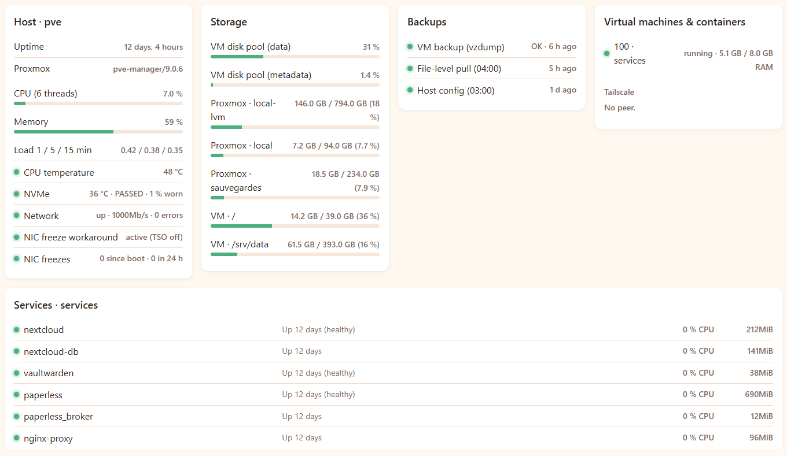

# Auto-hébergement pour une petite structure

Proxmox · Docker Compose · Nextcloud · Vaultwarden · Paperless-ngx · restic · shell POSIX



*Le tableau de bord du serveur, ici avec des données fictives : santé de l'hôte, remplissage des disques, fraîcheur des trois niveaux de sauvegarde et état de chaque service. Une sauvegarde qui échoue ou tarde y passe en alerte.*

Un modèle pour héberger soi-même, sur un seul mini PC, les outils de base d'une
petite entreprise ou d'une famille : **fichiers partagés, mots de passe, documents
scannés et classés**. Le plus important n'est pas l'installation, qu'on trouve partout,
mais ce qui la rend fiable dans la durée : **des sauvegardes vérifiées sur trois
niveaux et des alertes qui arrivent même quand le serveur est éteint.**

Tout vient d'une installation réelle, en service chez moi, réécrite ici en modèle
générique : domaines, adresses et comptes sont des variables.

## Ce que ça fournit

| Besoin | Service | Adresse |
|---|---|---|
| Fichiers partagés, synchro PC et téléphones | Nextcloud + MariaDB | `cloud.<domaine>` |
| Mots de passe partagés, applis mobiles | Vaultwarden (compatible Bitwarden) | `coffre.<domaine>` |
| Documents scannés, OCR, recherche plein texte | Paperless-ngx, alimenté par un dossier Nextcloud | `docs.<domaine>` |
| HTTPS et certificats automatiques | Nginx Proxy Manager (Let's Encrypt, DNS-01) | – |

## Architecture

```
                 internet (seul le 443 est ouvert sur la box)
                          │
┌─ mini PC : hôte Proxmox ─┼───────────────────────────────────────────┐
│                          ▼                                           │
│  ┌─ VM « services » (Docker) ─────────────────────────────┐          │
│  │  Nginx Proxy Manager ─► Nextcloud ─► MariaDB           │          │
│  │                     ├─► Vaultwarden                    │          │
│  │                     └─► Paperless ◄── dossier Nextcloud│          │
│  │  exports nocturnes ─► /srv/data/backups                │──┐       │
│  └────────────────────────────────────────────────────────┘  │ rsync │
│                                  (l'hôte tire, la VM n'a     ▼       │
│  surveillance.sh (5 min)          aucun accès à l'hôte)  SSD USB     │
└──────────┬────────────────────────────────────────────────────┬──────┘
           │ signaux                                              │
           ▼                                          restic chiffré
   healthchecks.io ─► e-mail, téléphone               (cloud ou machine amie)
```

## Sauvegardes

Trois niveaux : exports applicatifs cohérents dans la VM, copie sur le disque de
sauvegarde de l'hôte, copie hors site chiffrée. Le disque de données est exclu du
`vzdump` : seules les données utiles sont copiées (quelques centaines de Mo au lieu
de centaines de Go). Restauration testée. Détail, choix et pièges :
[docs/sauvegardes.md](docs/sauvegardes.md).

## Surveillance

Chaque tâche envoie un signal à healthchecks.io ; un échec **ou un silence** alerte
par e-mail et sur le téléphone. Toutes les 5 minutes, l'hôte vérifie machines,
services publics, certificats servis, disques et carte réseau :
[docs/surveillance.md](docs/surveillance.md).

## Retours d'expérience

- [Serveur allumé mais injoignable après un gros import](docs/incident-carte-reseau.md) :
  diagnostic d'un blocage de la carte réseau, correctif rendu permanent, vérifié
  après redémarrage, détection ajoutée à la surveillance.
- [Paperless alimenté par Nextcloud](docs/paperless-nextcloud.md) : déposer un
  document depuis le téléphone et le retrouver classé, et les quatre détails qui
  font que ça marche.

## Sécurité

- Un seul port ouvert (443). Certificats par défi DNS-01 : le port 80 reste fermé.
- Interfaces d'administration (Proxmox, proxy) joignables seulement sur le réseau
  local ou par VPN.
- Vaultwarden : inscriptions fermées, comptes sur invitation, administration coupée
  hors usage. Coffre chiffré côté client.
- SSH par clé uniquement, `root` refusé sur la VM.
- Secrets dans des `.env` en `chmod 600`, jamais dans le dépôt.
- La VM exposée à internet ne peut ni lire ni effacer ses sauvegardes.

## Mise en place

Prérequis : un hôte Proxmox VE, une VM Debian avec Docker, un nom de domaine dont le
DNS est géré par un fournisseur supporté par Let's Encrypt en DNS-01.

1. Copier `homelab.conf.example` en `/etc/homelab.conf` sur l'hôte et dans la VM, et
   l'adapter.
2. Dans la VM, pour chaque dossier de `services/` : copier `.env.example` en `.env`,
   le remplir, puis `docker compose up -d`.
3. Dans le proxy (port 81, depuis le LAN) : un hôte par service, certificat en DNS-01.
4. Copier `scripts/*.sh` dans `/usr/local/bin` (hôte et VM) et `cron/hote`, `cron/vm`
   dans `/etc/cron.d/homelab` de chaque machine.
5. Créer les contrôles sur healthchecks.io (noms = 1er argument de `avec-signal.sh`),
   mettre la clé de ping dans `/etc/healthchecks-ping-key` (`chmod 600`).
6. Job de sauvegarde Proxmox : disque de données de la VM en `backup=0`,
   `vzdump-signal.sh` en option `script`.
7. **Tester une restauration** avant de considérer que c'est fini.

## Limites

- Une seule machine : une panne matérielle coupe les services jusqu'à la
  restauration (quelques heures), sans perte de données au-delà de la dernière nuit.
- Les scripts visent Proxmox VE et Debian ; ailleurs, adapter les commandes `qm`,
  `pct`, `lvs`.
- Le modèle ne couvre pas la messagerie électronique, qu'il vaut mieux confier à un
  prestataire.

## Contexte

Cette installation sert au quotidien chez moi. Un tableau de bord dans
[ExziHub](https://github.com/Exzitech/exzihub-app), mon application de bureau, en affiche
l'état (machines, services, sauvegardes, certificats).

Je propose ce type d'installation, avec sa maintenance, à de petites structures qui
veulent garder leurs données chez elles.

Licence MIT.
